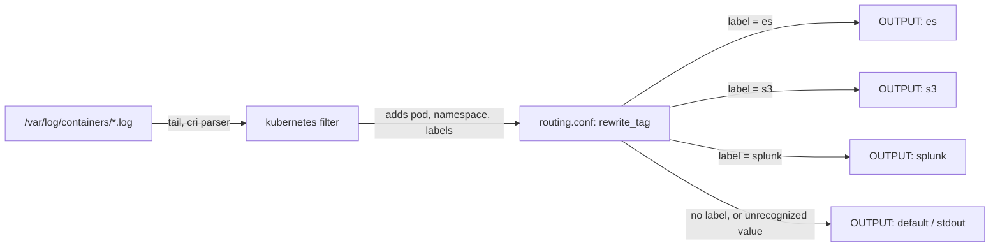

# fluentbit-k8s-log-routing

A reusable Fluent Bit config and DaemonSet that tails every container's logs on a node,
enriches each record with Kubernetes metadata, and routes it to one of three backends
(Elasticsearch, S3, Splunk) based on a pod label - so one team's logs can go somewhere
different from another's without separate DaemonSets.

**Scope.** This is the Fluent Bit config, the routing rule, and a plain-YAML DaemonSet
manifest - no Helm chart, no cluster, no real backend. Correctness is checked with
`fluent-bit --dry-run`, a routing test run through the real engine against a static fixture
(not a live cluster), and `kubeconform` on the DaemonSet YAML. Never run against a real
cluster or a real Elasticsearch/S3/Splunk endpoint - see Status below.

## Architecture



## Routing rule

Each pod can carry a label `logging.example.com/backend` with one of three values: `es`, `s3`,
or `splunk`. `routing.conf`'s `rewrite_tag` filter checks that label and rewrites the record's
tag accordingly, so the matching `OUTPUT` block picks it up. A pod with no such label, or any
value other than those three, keeps its original tag and lands on the default output instead -
visibly, not dropped. `routing.conf` is a single shared file, included by both the real
`fluent-bit.conf` and the test config, so the test exercises the exact rule production uses.

## Prerequisites

- A Kubernetes cluster with the `logging` namespace created (or edit the manifest's namespace).
- A `Secret` named `fluent-bit-backends` in that namespace with keys `ES_HOST`, `ES_INDEX`,
  `S3_BUCKET`, `S3_REGION`, `SPLUNK_HOST`, `SPLUNK_TOKEN` - see Usage below. None of these have
  a default; Fluent Bit prints a visible warning for each one left unset rather than silently
  using an empty value.
- For local validation only: Docker (to run the pinned `fluent-bit` image) and `kubeconform`.

## Usage

Create the backend secret first - never commit real values:

```bash
kubectl create secret generic fluent-bit-backends -n logging \
  --from-literal=ES_HOST=elasticsearch.example.com \
  --from-literal=ES_INDEX=k8s-logs \
  --from-literal=S3_BUCKET=example-logs-bucket \
  --from-literal=S3_REGION=us-east-1 \
  --from-literal=SPLUNK_HOST=splunk.example.com \
  --from-literal=SPLUNK_TOKEN=REPLACE_ME
```

Then apply the manifest:

```bash
kubectl apply -f deploy/daemonset.yaml
```

Label a workload to route its logs:

```bash
kubectl label deployment checkout logging.example.com/backend=es -n shop --overwrite
```

See `examples/sample-input.log` and `examples/expected-output.md` for a worked example of one
log line moving through the pipeline.

## Config files

- `fluent-bit.conf` - the real pipeline: `tail` input, `kubernetes` filter, the shared routing
  rule, and the three backend outputs plus the default.
- `parsers.conf` - the `cri` parser for `/var/log/containers/*.log`'s line format.
- `routing.conf` - the `rewrite_tag` rule, shared by production and by the test config.
- `deploy/daemonset.yaml` - `ServiceAccount` + `ClusterRole` + `ClusterRoleBinding` (the
  `kubernetes` filter needs to read pod/namespace metadata) + a `ConfigMap` holding the three
  config files above + the `DaemonSet` itself.

## Security considerations

- Every backend host, index, bucket, region, and token is `${ENV_VAR}` substitution in
  `fluent-bit.conf`, sourced from the `fluent-bit-backends` Secret via `envFrom` - never a
  literal value in this repo. No example or default anywhere uses a real host or token -
  `example.com` and `123456789012`-style placeholders only.
- A variable left unset is never silently treated as empty without a trace: Fluent Bit itself
  prints `[warn] [env] variable ${NAME} is used but not set` for each one, which `tests/run.sh`
  checks for directly.
- The container runs as a non-root user with a read-only root filesystem, no privilege
  escalation, and all Linux capabilities dropped (see `deploy/daemonset.yaml`'s
  `securityContext`). It only needs `get`/`list`/`watch` on `pods` and `namespaces` - nothing
  else.

## Idempotency

Applying `deploy/daemonset.yaml` repeatedly with unchanged content is a no-op, like any
declarative Kubernetes manifest. Fluent Bit's own log reading is itself idempotent in the sense
that matters here: it tracks its read offset per file, so a pod restart resumes rather than
re-shipping everything from the start of each log file (this is `tail`'s own built-in behavior,
not something this config adds).

## Tests

```bash
bash tests/run.sh
kubeconform -summary -strict -kubernetes-version 1.31.0 deploy/daemonset.yaml
```

`tests/run.sh` uses the pinned `fluent-bit` Docker image (no cluster, no real backend) to:

- Confirm `fluent-bit.conf --dry-run` succeeds both with every backend env var set (no warning)
  and with them all unset (each one individually reported via Fluent Bit's own `[warn] [env]`
  message, not silently ignored).
- Run `tests/fixtures/input.jsonl` - five records already shaped as if the `kubernetes` filter
  had enriched them - through the real engine via `tests/fixtures/test-fluent-bit.conf` (same
  `routing.conf`, `file` outputs instead of real backends, `Exit_On_Eof` so it processes the
  fixture once and exits instead of following forever like a live log tail). Asserts: the
  `es`/`s3`/`splunk`-labeled records land in their own output file; the unlabeled record and the
  record with an unrecognized label value (`carrier-pigeon`) both land on the default output
  instead of being dropped; every output file still carries the Kubernetes metadata fields.

`kubeconform -strict` (no `-ignore-missing-schemas`, no skip flag) validates all five resources
in `deploy/daemonset.yaml` against a pinned Kubernetes version.

## Status

Never run against a real cluster, a real Elasticsearch/S3/Splunk backend, or real
`/var/log/containers/*.log` files. Validated only with `fluent-bit --dry-run`, the
fixture-based routing test described above, and `kubeconform` on the DaemonSet YAML. The real
`kubernetes` filter's live metadata lookup against an API server has never been exercised -
the routing test assumes that enrichment already happened and only tests what comes after it.

## Known limits

- Only three backends and one routing label, matching the problem statement exactly - no
  additional outputs, no multi-label routing, no templating beyond `${ENV_VAR}` substitution.
- The DaemonSet's `readOnlyRootFilesystem` assumes Fluent Bit's default in-memory buffering;
  switching to on-disk chunk buffering would need a writable `emptyDir`, not included here since
  it isn't used.
- No retry or backpressure handling beyond what each output plugin already does on its own.
